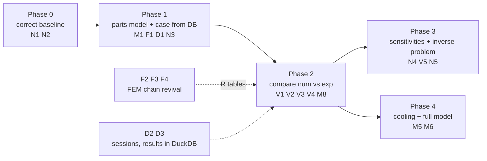

# magnet-scipy — Roadmap

*Snapshot: 2026-11-12 · branch `claude_cleanup`*

The goal is to make magnet-scipy the **replay and comparison engine** of the LNCMI
digital twin. Pick a real run, build its ODE case from the database and the
numerical models, simulate it, compare it with the measurements, and explain
the differences: wrong parameters, a missing physical effect, or a sensor
problem.

This file **links to** the detailed plans in [prompts/](prompts/) instead of
repeating them. The plans for the database and the sibling packages live in
`magnetdb-duckdb-demo` (its own `ROADMAP.md` and `PLAN_*.md`).

**Legend.**
Status: ✅ done · 🔄 in progress / partial · 📝 plan drafted, awaiting approval ·
💡 idea, no plan yet · ⛔ blocked on external input · ⏸ deferred.
Effort (relative, no calendar): S · M · L · XL · ?.
*Uncommitted*: the plan file is in the working tree but not in git yet.

---

## Tracks at a glance

| Track | Scope | Next step |
|---|---|---|
| [N](#n--numerics-and-solvers) | solver correctness, benchmarks, JAX/diffrax, SUNDIALS | inductance-matrix follow-ups (N2), then extend the benchmark (N3) |
| [M](#m--physical-model) | parts/elements, R models, field → references, cooling, full model | element voltages (M1) |
| [F](#f--numerical-models-fem-geometry-inductance) | magnetworkflows, magnetgmsh, Salome, magnettools | inductance CSV from the DB (F1), then revive magnetworkflows (F2) |
| [D](#d--data-and-database) | case directory from DuckDB, sessions, results storage | `ode-config` builder prototype (D1) |
| [V](#v--validation-and-inverse-problem) | R/L comparison, prediction-vs-reality differences, identification | method A (R from pupitre plateaus) (V2) |
| [H](#h--housekeeping) | CLI cleanup, deprecations, docs, packaging | as files are touched |

---

## Phases (suggested order)

Each phase only needs the earlier ones. Tracks F and D can run in parallel
with phases 1–2.

| Phase | Why this order |
|---|---|
| **0 — Correct baseline** | Benchmarks and comparisons mean nothing while known bugs bias the voltage (e.g. `np.gradient` gives about 2 % error at gain switches) or hide failed runs. |
| **1 — Parts model + case from the DB** | Every comparison is per element (taps `Ucoil<k>`, `Interne<k>`, `Externe<k>`), so we need R and M per element first, and reproducible cases built from the DB instead of by hand. |
| **2 — Numerical vs experimental** | Direct estimates (no inverse problem) answer most of the "R and L, model vs reality" question and give the starting point for phase 3. Screens (M8) belong here: without their eddy currents, the ramp-corner inductance estimates (V3) absorb their effect. |
| **3 — Sensitivities + inverse problem** | Only worth it once phase 2 shows which residuals remain. JAX/diffrax provides the derivatives. |
| **4 — Cooling + full model** | Replaces the exogenous `Tin`. Also checks the `T*` sensors by calorimetry. |

---

## N — Numerics and solvers

| # | Item | Status | Effort | Plan / evidence |
|---|---|---|---|---|
| N1 | Fix the bugs confirmed by the theory review. All fixed, regression tests in `tests/test_n1_regressions.py`: failed coupled run reported as success; PID voltage rebuilt with `np.gradient` (now exact `de/dt = di_ref/dt − di/dt` from the vector field); signed vs `abs(i)` current in single vs coupled R (`RLCircuitPID.get_resistance` uses `abs(i)`); `hybrid` picked when every circuit has both CSVs (now `pid`, as for a single circuit); reference CSV extrapolation (`csv_utils.py:41`). | ✅ | S | [scipy_theory_review.md](prompts/scipy_theory_review.md) |
| N2 | Inductance-matrix follow-ups: shared `_build_inductance_matrix`, re-validation in `update_mutual_inductance`/`add_circuit`, `eigvalsh`, error when `mutual_inductances` is missing, remove the `pinv` fallback (`coupled_circuits.py:212,253`). The constructor part is done (`test_inductance_config.py`). | 🔄 | S | [inductance_matrix_followups.md](prompts/inductance_matrix_followups.md) |
| N3 | **Benchmark of the methods.** Done: `solve_ivp` methods on the `examples/` cases, cost + error vs measurement + error vs a reference solution. To add: piecewise integration restarted at the known breakpoints (reference corners, gain-region switches) vs `max_step`; diffrax (N4) and SUNDIALS (N5) as extra backends with the same `accuracy.csv` output. | 🔄 | M | [benchmarks/README.md](benchmarks/README.md), `03987e4` |
| N4 | **JAX/diffrax implementation with sensitivities.** Step 1: the demonstrator (per-sequence `Kvaerno5`, exact `i_ref` on each sequence, same R grid in JAX, validated against the exact LTI solution and against scipy). Step 2: forward sensitivities `jax.jacfwd` with respect to R scales, K entries and PID gains (input to V5). Stays an optional `jax` extra. | 📝 | L | [diffrax_demonstrator.md](prompts/diffrax_demonstrator.md), [parameter_identification.md §D](prompts/parameter_identification.md) |
| N5 | **SUNDIALS implementation?** Candidate: CVODE(S) through a Python binding (scikit-sundae, scikits.odes or Assimulo, to be compared). Pros: stiff BDF with event/root handling, forward/adjoint sensitivities built in (CVODES), IDA if the cooling model makes the system a DAE. Decide after N3 + N4: only go ahead if it clearly beats diffrax or scipy `Radau`/`BDF` on the stiff PID cases. | 💡 | M | — |
| N6 | PID integral form: does the real regulator integrate `Ki·e` (bumpless transfer) or `Ki·∫e`? This changes the model's second state. Needs the CIRRUS documentation. | ⛔ | S | [scipy_theory_review.md](prompts/scipy_theory_review.md) "Open modelling question" |

---

## M — Physical model

| # | Item | Status | Effort | Plan / evidence |
|---|---|---|---|---|
| M1 | **Resistance/inductance per part** (elements in series per circuit): `R_<elem>` columns auto-detected, magnettools site matrix with `matrix_group`, `M = Pᵀ M_elem P`, post-processed `U = U_R + U_L_own + U_M_other` per element. Needs N2 step 2. | 📝 | M | [element_voltages.md](prompts/element_voltages.md) |
| M2 | **Reference resistance together with the inductance?** Add the pupitre monitoring model `(R00 + A·I + B·I²)(1 + ct·T)` per section as an R source, next to the per-element inductance, so a replay can use the operators' reference R. Open point: it needs a mean temperature `(Tin + Tout)/2` with a known lag, while magnet-scipy's R takes `(I, Tin)` only. | 💡 | S | [reference-resistance.md](reference-resistance.md), [ode_config_from_magnetdb.md](prompts/ode_config_from_magnetdb.md) decision 2c |
| M3 | **Fix the temperature coefficient in the materials table.** `materials.alpha` (DB) and the pupitre `ct` are rarely updated when the material changes. Fit α per element from V2 (plateaus at several `Tin`), compare with `materials.alpha` and the header `ct`, then correct the table (DB side) and regenerate the R(I, T) tables (F3). Theory: `R ≈ R0[1 + α(⟨T⟩_w − T0) + α²σ²_w]`. | 💡 | M | [resistance-temperature.md](resistance-temperature.md), `magnetdb-duckdb-demo/PLAN_digital_twin_schema.md` (`ct` vs `materials.alpha`) |
| M4 | **Formula B(demand) and reference currents.** From a requested field B, compute `I_ref` per supply group with the field factors (MAGFILE) and the operating rules (current split H/B), so a simulation can be driven by a field demand instead of a recorded `Référence_GR<n>`. Also check: recorded references vs this formula. Field-factor study not approved yet on the DB side. | 💡 | M | `MAGFILE*.conf` (untracked), `magnetdb-duckdb-demo/PLAN_header_field_factor_study.md` |
| M5 | **Cooling model.** Tier 1: 0D calorimetric loop (branches, mixing, UA-free exchanger from `Teb`/`Tsb`), mainly to check the sensors, optionally fed back into `R(I, Tin)`. Tier 2a (node method) or 2b (finite volume) only if the tier-1 residuals show transit delay. | 📝 | L | [cooling_model.md](prompts/cooling_model.md), [cooling_model_node_method.md](prompts/cooling_model_node_method.md), [cooling_model_finite_volume.md](prompts/cooling_model_finite_volume.md) |
| M6 | **Full model** ("modèle tout"): field demand (M4) → references → PID per supply → coupled circuits per element (M1) → R(I, T) with T from cooling (M5) → predicted U per tap, `Tout`, flows. One config, one run, compared with every measured channel. This is the integration milestone; it brings no new physics. | 💡 | XL | — |
| M7 | PSIM co-simulation (DLL block for R(I, T), gain schedule, M solve). | ⏸ | L | [psim_coupling.md](prompts/psim_coupling.md) |
| M8 | **Passive circuits / screens.** Screens split into `n_r × n_z` short-circuited elements (my-magnettools `mt.SplitScreen`, labels `Sc<i>_<k>`) become passive rows (`u = 0`) of the coupled system. A general coupled RHS with a role per row (PID / voltage / passive) replaces `HybridStrategy`: one Cholesky-factored `M + diag(Kd)` per gain region, analytic Jacobian for Radau/BDF. Needs M1 step 3 (element matrix, `P`) and N2 steps 3 and 6 (`eigvalsh`, no `pinv`). Planned: stage A, constant ρ from the config, run at a low/high bound. Later: B, ρ(T, \|B\|) with field factors from magnettools; C, screen thermal state (cryogenic cooling). B and C need the screen material/RRR, the cooling type, and a place for material laws in the DB. | 📝 *uncommitted* | L | [passive_circuits_screens.md](prompts/passive_circuits_screens.md) |

---

## F — Numerical models (FEM, geometry, inductance)

These items live mostly in sibling repositories. magnet-scipy only reads the
files they produce (CSV + provenance), so it stays free of Feel++, gmsh, Salome
and magnettools dependencies.

| # | Item | Status | Effort | Plan / evidence |
|---|---|---|---|---|
| F1 | **Numerical inductance matrix** from the DB with magnettools: `export_inductance_matrix.py` (site CSV + `_summary` + `_labels` sidecar), checked against the hand values in `circuits.json` (`L = 0.002315`, `0.01254`, `M = 0.001965` H). Unblocks M1 step 6. | 📝 | M | [inductance_csv_from_duckdb.md](prompts/inductance_csv_from_duckdb.md) |
| F2 | **Bring python_magnetworkflows back into service**: run Jérémie's example (`jeremie-mworkflows`, `cfpdes-thelec-Axi`) in the current Feel++ container; waterflow (flow law per magnet, `flow_params` is empty in the DB); consolidate the lag and signatures (shared with D4); compute the inductance matrix numerically (FEM) as a cross-check of F1. | 💡 | L | `~/github/jeremie-mworkflows`, `~/github/python_magnetworkflows` (branch `separate-cooling`) |
| F3 | R(I, T) tables from magnetworkflows: a cached `run_r_table(...)` step (one run per I step × `Tin`), converted to `R_<magnet>.csv`. Needs F2 + `flow_params`. | 📝 | L | [ode_config_from_magnetdb.md](prompts/ode_config_from_magnetdb.md) step 3 |
| F4 | **python_magnetgmsh: `MSite` → `Assembly`** (Track B of the rename, deferred so far). Needed so meshes come from the same DB assemblies as F1/F3. | 💡 | M | `magnetdb-duckdb-demo/PLAN_site_to_assembly_rename.md` "Track B" |
| F5 | **hifimagnet.salome: same rename.** | 💡 | M | same |

---

## D — Data and database

| # | Item | Status | Effort | Plan / evidence |
|---|---|---|---|---|
| D1 | **ODE case from an overview record**: `ode-config --record NAME` writes `circuits.json`, R tables, inductance CSV, `reference_GR<n>.csv`, `Tin_GR<n>.csv`, `measured/`, `provenance.json`. Prototype of the digital-twin phase 4, which does not wait for L1–L3. Acceptance: rebuilds `examples/M9_M23072801/circuits-pid-temp.json`. | 📝 *uncommitted* | L | [ode_config_from_magnetdb.md](prompts/ode_config_from_magnetdb.md) |
| D2 | **Improve overview records with sessions** (in parallel): link each overview record to its `magnetrun sessions` record (pupitre + archive + runlog), so D1 finds the 120 Hz Archive and the pupitre file of a run without manual search. Session records exist (`python_magnetrun` `a77f37c`); step R (runlog path) awaits approval. | 🔄 | M | `magnetdb-duckdb-demo/PLAN_session_records.md` |
| D3 | **Integrate with DuckDB? A structure to receive the results and use them.** A `simulations` table (L5 in the digital-twin schema): inputs = `provenance.json`, outputs = per-channel residual metrics + a parquet of the time series, keyed by record + model version. magnet-scipy writes files; `to_duckdb` loads them. Uses: dashboard comparison, tracking R/L drift across runs. | 💡 | M | `magnetdb-duckdb-demo/PLAN_digital_twin_schema.md` (L5) |
| D4 | Clock lag pupitre ↔ pigbrother and reference signatures (`sync_info`, `signatures`; S2 on the DB side). Until S2 exists, D1 estimates the lag by cross-correlation and stores it in `provenance.json`. | ⛔ | M | [ode_config_from_magnetdb.md](prompts/ode_config_from_magnetdb.md) step 5 |
| D5 | Open data questions: PID ↔ group swap on M9 (XML vs `circuits-pid-temp.json`); M19 not in the DB, M9/M10 power split labels. | ⛔ | — | [ode_config_from_magnetdb.md](prompts/ode_config_from_magnetdb.md) decisions 4–5, [parameter_identification.md](prompts/parameter_identification.md) decision 6 |

---

## V — Validation and inverse problem

| # | Item | Status | Effort | Plan / evidence |
|---|---|---|---|---|
| V1 | Readers for pupitre `.txt` and pigbrother TDMS, plus the tap ↔ element mapping (by name, not by position: Bitters `Be`/`Bi` order). | 📝 *uncommitted* | M | [parameter_identification.md](prompts/parameter_identification.md) step 2 |
| V2 | **Numerical vs experimental resistances**: method A, `R_a = ⟨U_a⟩/⟨I⟩` on pupitre plateau tails, compared with the FEM tables (F3) and the pupitre reference model (M2). Also gives α per element (M3). | 📝 *uncommitted* | M | [parameter_identification.md](prompts/parameter_identification.md) method A |
| V3 | **Same comparison for the inductance**: method B, linear least squares on integrals over windows at the ramp corners, 120 Hz Archive only (the 1 s pupitre skew biases L by up to 70 %). Gives `K = M_elem·P` with bootstrap CI and SVD identifiability, compared with magnettools (F1) and FEM (F2). M19 provides a null test (`M_{M9,M10} ≈ 0`). | 📝 *uncommitted* | M | [parameter_identification.md](prompts/parameter_identification.md) method B |
| V4 | **How to find the differences between predictions and reality.** Post-processing module `magnet_scipy/residuals.py` on the saved `.npz`; no solver change. Residuals in physical units (closed loop: the plant error is in `r_U`), segmented by regime (plateau / ramp / kink / gain switch). Per-segment fit `r_U ≈ ΔU₀ + ΔR·I + ΔL·dI/dt`; ΔL and time skew are collinear on ramps. A model-free consistency residual flags sensor faults. Windows above k·σ with hysteresis, labelled sensor / actuator / offset / resistance / inductance_or_skew / unexplained; time-weighted metrics per channel for D3. Normalisation and DTW are kept only as optional diagnostics. Demonstrators: C0 baseline; C7 230919, a converter trip with the M coupling transient and a frozen DCCT; C7 240716, the negative control; C9 240804, insert `Interne7` spikes, the 1 Hz detection limit. Decision: the PID model has no voltage limit, so a closed-loop trip replay is unphysical (v1 labels trips from the measurements). Open loop needs V5 method C. | 📝 *uncommitted* | M | [signal_residual_analysis.md](prompts/signal_residual_analysis.md), [test_campaign_M23072801.md](prompts/test_campaign_M23072801.md) C7/C9, [time_weighted_metrics.md](prompts/time_weighted_metrics.md); background: [signal-difference.md](prompts/signal-difference.md), [signal-difference-dtw.md](prompts/signal-difference-dtw.md) |
| V5 | **Inverse problem**: open-loop validation driven by the measured voltages (method C), sensitivity ranking and Fisher information for experiment design (D), output-error least squares with Cholesky-parameterized L (E) only if C leaves structured residuals. Adjoint (`RecursiveCheckpointAdjoint`) only if the parameter count grows (R grids, T field). | 📝 *uncommitted* | L | [parameter_identification.md](prompts/parameter_identification.md) methods C–E |
| V6 | Calorimetric closure on long plateaus, `Σ U_a·I` vs `ρ c_p (Q1 + Q2)(Tout − T̄in)`: checks both the taps and the thermometers. Shared with M5 tier 1. | 💡 | S | [parameter_identification.md](prompts/parameter_identification.md) "To check" |

---

## H — Housekeeping

Do these as files are touched, following the deprecation-shim pattern in
[CLAUDE.md](CLAUDE.md). They are not a goal of their own.

| # | Item | Status | Plan / evidence |
|---|---|---|---|
| H1 | Finish the CLI/plotting integration, then remove the legacy classes (`ResultProcessor`, `PlottingManager`, …) at a major version. | 📝 | [update_plotting.md](prompts/update_plotting.md), [next_integration_prompt.md](prompts/next_integration_prompt.md), [removing_backward_compatible_methods.md](prompts/removing_backward_compatible_methods.md) |
| H2 | Remove the `*.old`/`*.old1` modules from `magnet_scipy/` and the scratch files at the repo root (PNG, CSV, `.tgz`). Confirm with the author first. | 💡 | `git status` |
| H3 | README todos still open: 2D extrapolation, units from `[...]` headers converted to SI, `time_start`/`time_end` bounded by the input CSV, per-circuit experimental data, coupled-main tests (M = 0 / M ≠ 0). | 🔄 | [README.md](README.md) "todos" |
| H4 | Theory note: document the voltage-driven model, R(I, T) clamping and the "missing grid point → 0 Ω" behaviour; replace the textbook ranges with LNCMI values. | 📝 | [scipy_theory_review.md](prompts/scipy_theory_review.md) |
| H5 | Docker bake images per matplotlib backend. | 📝 | [docker_bake_backends.md](prompts/docker_bake_backends.md) |
| H6 | Package name: `pyproject.toml` still says `magnet_diffrax`. | 💡 | `pyproject.toml` |

---

## Where each goal went

The original list of goals (in French), with the items it maps to. The
**interpretation** column shows where the wording was open; correct it here if
the reading is wrong.

| Goal | Items | Interpretation |
|---|---|---|
| Benchmark des méthodes | N3 | scipy part done; add piecewise, diffrax, SUNDIALS |
| Implémentation jax avec calcul des sensibilités | N4, V5 | forward sensitivities first; adjoint only if p grows |
| Implémentation sundials ? | N5 | decide after N3/N4 benchmarks |
| Problème inverse | V5 (after V2, V3) | direct estimates first, ODE output error only if needed |
| Remettre en service magnetworkflows — exemple de Jérémie — waterflow — consolider lag et signatures — calcul matrice inductance en numérique | F2, F3, D4 | FEM inductance seen as a cross-check of magnettools (F1) |
| Magnetgmsh : version msite_to_assembly | F4 | Track B of the rename plan |
| Salome : idem | F5 | same |
| Comparer résistances numériques et expérimentales, même chose pour inductance | V2, V3 | |
| En parallèle améliorer overview-record avec session ? | D2 | link overview records to `magnetrun sessions` |
| Intégrer à duckdb ? Structure pour recevoir résultats et les utiliser | D3 | magnet-scipy writes files, `to_duckdb` loads them (no DB dependency here) |
| Corriger coefficient de température dans la table matériaux | M3 | fix data on the DB side; α estimated from V2 |
| Intégrer résistance de référence avec inductance ? | M2 | *read as*: pupitre reference R model as an R source in element mode |
| Comment trouver différences entre prédictions et réalité ? | V4 | residual classification by regime and signature |
| Formule B demande et courants de référence | M4 | *read as*: field demand → `I_ref` per group via field factors |
| Modèle tout | M6 | *read as*: end-to-end integration of M1, M4, M5 |
| Modèle pour refroidissement | M5 | tier 1 first |

---

## Open decisions (blocking or shaping several items)

1. **Where DB-facing code lives**: in `magnetdb-duckdb-demo/to_duckdb/` (recommended
   in D1/F1, magnet-scipy stays file-only) or as an optional magnet-scipy module?
2. **R source for the first replays**: existing CSVs now, FEM tables (F3) as the
   reference, pupitre model (M2) as a cross-check?
3. **Readers**: python_magnetrun as an optional dependency, or CSV exports from it (V1)?
4. **diffrax location**: standalone `examples/` script or `magnet_scipy/diffrax_backend.py`
   (needed if N3 benchmarks it through the CLI)?
5. **Bumpless PID** (N6) and **PID ↔ group on M9** (D5): both need operator/CIRRUS input.
6. **Commit the uncommitted plans** (`ode_config_from_magnetdb.md`,
   `parameter_identification.md`, `signal_residual_analysis.md` (+ background `signal-difference*.md`),
   `passive_circuits_screens.md`) so this roadmap's links
   work on other clones.
